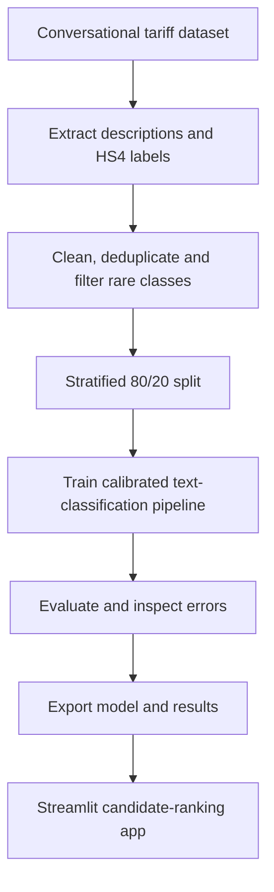

# HS4 Code Prediction

### Product Classification using Word + Character TF-IDF and Calibrated Linear SVM


An NLP project that predicts **three candidate four-digit Harmonized System (HS4) headings** from a product description.

The project covers conversational data extraction, text cleaning, class imbalance, word and character features, probability calibration, evaluation, error analysis and Streamlit deployment.

The application is a **candidate-ranking prototype for human review**. Performance varies on unfamiliar descriptions, and predictions are restricted to headings represented in training.

## 🚀 Live Demo

**[Try the HS4 Code Prediction App](https://hs4-code-prediction-wampk2tvldwfbcgrfjmkfy.streamlit.app/)**

Describe one product, including its material, function and construction. The app displays three candidate headings with model scores and lets users check whether a known heading is supported.

Scores are ranking aids, not guarantees of correct classification.

## 📌 Project Motivation

My experience assigning HTS codes to ASINs for the Canada marketplace inspired this project.

The project explores whether text classification can help identify candidate tariff headings for review. It uses a public dataset containing US tariff-classification answers and predicts four-digit HS headings rather than complete country-specific tariff codes.

## 🔄 Workflow



## 📊 Evaluation Results

The model was trained on **11,904 records** and evaluated on **2,976 development holdout records** across **252 supported headings**.

| Metric | Result |
|---|---:|
| Top-1 Accuracy | **69.83%** |
| Top-3 Accuracy | **81.59%** |
| Macro F1-score | **0.5877** |
| Majority-Class Baseline Accuracy | 7.09% |
| Correct Top-1 Predictions | 2,078 |
| Incorrect Top-1 Predictions | 898 |

- **Top-1 accuracy:** the first candidate matches the dataset label.
- **Top-3 accuracy:** the dataset label appears among the three candidates.
- **Macro F1:** the average class-level F1-score, giving each heading equal weight.
- **Majority baseline:** always predicts the most frequent training heading, `6110`.

**Evaluation scope:** the holdout was inspected during development and comparison of approaches. These results are development estimates, not an untouched final or external benchmark. They do not establish accuracy across all product categories.

## 🗂️ Dataset

The project uses the training split of the publicly available [CROSS Rulings HTS Dataset](https://huggingface.co/datasets/Dayanand314Krishna/cross_rulings_hts_dataset_for_tariffs).

**Dataset revision:** `0a66ad345d3fc9828f362836d86b31e20798513c`

**Dataset attribution:**

> CROSS Rulings HTS Dataset for Tariff Classification by Flexify.AI Inc. (https://www.flexify.ai)

The source contains conversational examples in a `messages` field. The notebook extracts the user description as the input and an HS4 heading from the assistant answer as the target.

Assistant reasoning is not used as a model feature.

### Data Preparation

| Processing Stage | Records |
|---|---:|
| Original source records | 18,254 |
| Valid descriptions and parsed codes | 18,233 |
| After removing conflicting descriptions | 17,509 |
| After exact duplicate removal | 15,697 |
| After rare-class filtering | **14,880** |
| Training split | 11,904 |
| Development holdout split | 2,976 |

Cleaning includes:

1. Extract product descriptions and candidate labels.
2. Lowercase and trim descriptions.
3. Retain four-digit labels and descriptions longer than ten characters.
4. Remove identical descriptions associated with conflicting labels.
5. Remove exact duplicate description–label pairs.
6. Exclude headings with fewer than ten examples.
7. Create a stratified 80/20 split using random seed `42`.

The parser selects the first dotted tariff code in an answer, with a standalone four-digit fallback. This can introduce label noise when answers contain several classifications or incidental numbers.

Conflict removal and class filtering define the curated dataset before splitting. Evaluation is conditional on that dataset.

## 🧠 Model Architecture

### Word and Character Features

Features are combined using Scikit-learn’s `FeatureUnion`.

| Setting | Word TF-IDF | Character TF-IDF |
|---|---|---|
| Analyzer | `word` | `char_wb` |
| N-gram range | `(1, 2)` | `(3, 5)` |
| Minimum document frequency | `2` | `2` |
| Maximum features | `30000` | `30000` |
| Sublinear term frequency | `True` | `True` |

Word features capture product terms and phrases. Character features capture patterns within words and variations in terminology.

### Linear SVM and Calibration

The classifier uses:

```python
LinearSVC(
    C=1.0,
    class_weight="balanced",
    max_iter=5000,
    random_state=42
)
```

The complete TF-IDF and SVM pipeline is placed inside:

```python
CalibratedClassifierCV(
    estimator=base_pipeline,
    cv=3,
    method="sigmoid",
    n_jobs=-1
)
```

**TF-IDF is fitted separately within each calibration fold.** The vocabulary and IDF weights are learned from that fold’s training portion, keeping its calibration portion out of preprocessing fitting.

The outer holdout is excluded from model fitting.

Calibration produces probability estimates, but those estimates can remain poorly calibrated. No validated deployment review threshold is established.

## 🔎 Error Analysis and Coverage

The notebook exports all holdout predictions, incorrect Top-1 predictions and a per-class classification report.

### Supported-Class Coverage

| Measure | Result |
|---|---:|
| Eligible deduplicated records before rare-class filtering | 15,697 |
| Records retained after filtering | 14,880 |
| Record retention | **94.80%** |
| Distinct headings identified by the parser | 548 |
| Supported headings | 252 |
| Distinct parsed-code coverage | **45.99%** |

Record retention is not coverage of the complete HS system. Many parser-derived headings are excluded, and the model cannot predict headings outside its learned label set.

### Similarity Diagnostic

Each holdout description is compared with its nearest training description using a TF-IDF representation fitted on training text only.

| Nearest-Training Cosine Similarity | Records | Top-1 Accuracy | Top-3 Accuracy |
|---|---:|---:|---:|
| 0–0.25 | 87 | 39.08% | 54.02% |
| 0.25–0.50 | 1,482 | 59.31% | 73.68% |
| 0.50–0.70 | 739 | 79.16% | 90.53% |
| 0.70–0.85 | 369 | 86.72% | 92.41% |
| 0.85–1.00 | 299 | 86.96% | 93.31% |

Accuracy is lower for less familiar descriptions. There are **196 holdout records with similarity ≥0.90** to a training description.

High similarity does not alone prove leakage, but related products or rulings across the random split may make performance look stronger than performance on entirely new product families.

### Probability Reliability

Five-bin top-label Expected Calibration Error is **0.1951** on the development holdout. The reliability table shows substantial underconfidence.

This diagnostic does not validate an unsupported-class detector. A high score can still accompany an incorrect prediction.

## ⚠️ Limitations

- Predictions are restricted to 252 learned headings.
- Rare and absent headings cannot be reliably handled by this classifier.
- Source-answer parsing can introduce incorrect or ambiguous labels.
- Source labels have not been independently verified against customs rulings.
- Exact duplicates are removed, but related descriptions can remain across splits.
- The holdout was inspected during development.
- Manual checks show uneven performance on new descriptions.
- Calibration does not guarantee reliable probability estimates.
- No validated uncertainty threshold or missing-class detector is established.
- HS4 headings are not complete country-specific tariff codes.

**This project is for portfolio and educational purposes. Verify classifications using authoritative tariff guidance and qualified review.**

## ▶️ Reproduce the Project

### Train in Google Colab

1. Open `hs4_code_classifier.ipynb` in Google Colab.
2. Select **Runtime → Run all**.
3. Restart the session if prompted after dependency installation, then run from the top.
4. The notebook downloads the pinned dataset version and trains a fresh model.
5. Download `hs4_project_outputs.zip` from the Colab Files sidebar.
6. Save the executed notebook with outputs.

**No pretrained model upload is required for training.**

The ZIP contains the newly trained model, metadata, prediction files and diagnostics.

### Run the App Locally

```bash
git clone https://github.com/Ayesha-Ansa/hs4-code-prediction.git
cd hs4-code-prediction
python -m pip install -r requirements.txt
streamlit run app.py
```

The app downloads the versioned model release on first launch and verifies its checksum. Internet access is required for that download.

## 📁 Project Files

| File | Purpose |
|---|---|
| `hs4_code_classifier.ipynb` | Data preparation, fresh training, evaluation and analysis |
| `app.py` | Streamlit prediction interface |
| `requirements.txt` | App dependencies |
| `model_info.json` | Readable model metadata and package versions |
| `model_info.pkl` | Serialized model metadata |
| `model_evidence_summary.csv` | Evaluation metrics and prediction counts |
| `test_predictions.csv` | All development holdout predictions |
| `wrong_predictions.csv` | Incorrect Top-1 predictions |
| `classification_report.csv` | Per-class evaluation |
| `coverage_funnel.csv` | Dataset preparation counts |
| `confidence_reliability.csv` | Score reliability diagnostic |
| `near_duplicate_analysis.csv` | Nearest-training similarity analysis |
| `split_membership.csv` | Record assignment to training and holdout splits |

The trained model is distributed through [GitHub Releases](https://github.com/Ayesha-Ansa/hs4-code-prediction/releases/tag/v3.0.0).

## 🛠️ Technologies Used

Python · Pandas · NumPy · Scikit-learn · TF-IDF · Linear SVM · Probability Calibration · Hugging Face Datasets · Joblib · Streamlit · Google Colab

## 🔮 Future Improvements

- Audit source labels, especially multi-product and multi-code answers.
- Collect examples for underrepresented headings.
- Evaluate using grouped product/ruling splits and an independent benchmark.
- Test rejection strategies using both supported and unsupported classes.
- Explore reference search over a complete HS heading catalogue.
- Improve robustness to shorter and unfamiliar product descriptions.

## 👩‍💻 Author

**Ayesha Ansari**

Data Science & AI | Machine Learning | NLP
